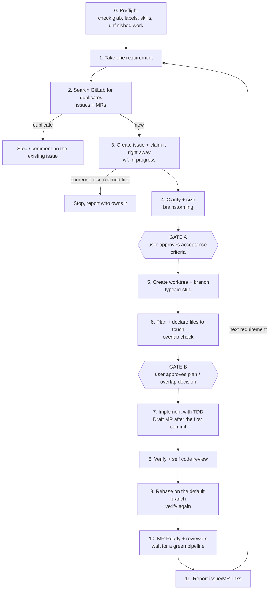

# AI Workflow: Requirement → Merge Request

A workflow in which Claude Code takes requirements **one at a time** and loops until a Merge Request
is open on GitLab. Several people can use it at once without duplicating or overwriting each
other's work (team rules: [collaboration.md](collaboration.md)).

| Document | Read it when |
|---|---|
| [setup.md](setup.md) | First-time setup, onboarding a new dev, or adopting the workflow in another repo |
| [collaboration.md](collaboration.md) | Team rules: claims, labels, branches, file overlap |
| [skills.md](skills.md) | Which skills are used, why they were (not) chosen, how to add a new one |
| `.claude/skills/req-to-mr/SKILL.md` | The exact steps the agent follows (source of truth for commands) |

## Getting started

Open Claude Code at the repo root and type:

```text
/req-to-mr
```

Or just type a requirement, e.g. `Make the login page remember the last email used`, and the
agent enters the workflow on its own.

Other commands:

| Command | What it does |
|---|---|
| `/req-to-mr resume 123` | Continue issue #123 where it was left off (e.g. after a previous session ended) |
| `/req-to-mr review 45` | Address reviewer comments on MR !45 and reply on every thread |
| `/req-to-mr release 123` | Hand issue #123 back so someone else can pick it up |

## The loop



## Where a human decides (gates)

The agent runs the loop on its own, except at these points, where it always **stops and asks**:

| Point | Question |
|---|---|
| Phase 2 | A possible duplicate issue/MR was found: continue, link it, or stop? |
| **GATE A** (Phase 4) | Are the acceptance criteria and scope right? Should this be split into several issues? |
| **GATE B** (Phase 6) | The plan, the execution method (inline / subagents), and how to handle any file overlap with others' work |
| Along the way | Claim lost, rebase conflict with another open MR's code, verification still failing after 3 rounds, secrets, or anything irreversible |
| After the MR is open | **Humans always review and merge.** The agent never merges, approves or sets auto-merge (enforced by a hook) |

## What each requirement leaves on GitLab

- An **issue** with complete acceptance criteria and a `wf::*` label showing its status
- A **claim comment** (🔒) showing who owns the work
- A **planned files comment** (🗂️) listing the files to be changed, so teammates' overlap checks see it before any code exists
- A **plan summary comment** describing the approach
- An **MR** (Draft from the first commit → Ready) with `Closes #iid`, an acceptance criteria → evidence table, and verification results

Local-only data (never committed): `.wf/plans/`, issue/MR drafts in `.wf/`, and worktrees in `.claude/worktrees/`.

## Workflow files

```text
CLAUDE.md                          # short rules + "AI workflow settings" (test/lint/build commands, reviewers)
.claude/skills/req-to-mr/          # orchestrator skill (all the steps)
.claude/skills/<others>/           # skills installed from skills.sh (see skills.md)
.claude/hooks/guard-git.sh         # blocks pushing to main, force-push, merging/approving MRs
.claude/settings.json              # registers the hook
skills-lock.json                   # pins skill versions so everyone uses the same set
scripts/wf/preflight.sh            # readiness check + your own / the team's unfinished work
scripts/wf/claim.sh                # claim / release / take over an issue
scripts/wf/overlap.sh              # detect file overlap with open MRs and in-progress issues
scripts/wf/setup-labels.sh         # create the wf::* labels (once per project)
.gitlab/issue_templates/Requirement.md
.gitlab/merge_request_templates/Default.md
```
